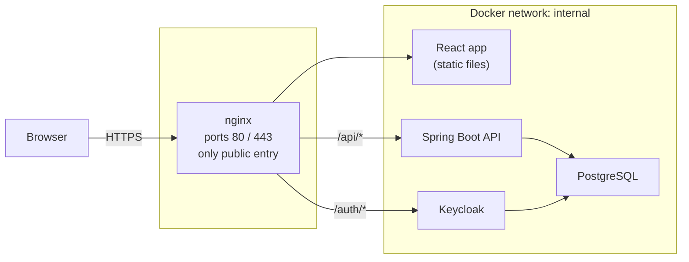
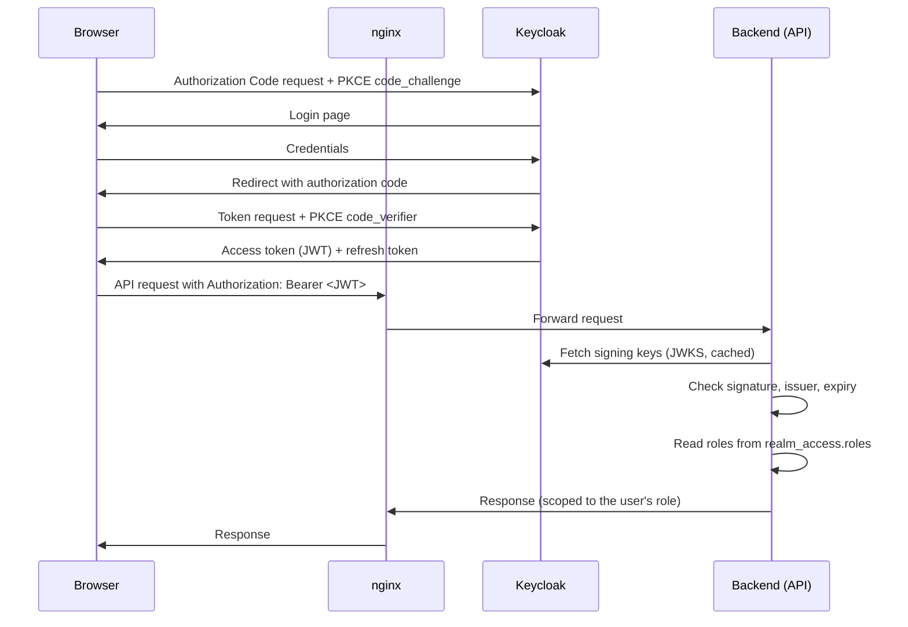

# Library Management System

A small full-stack app for keeping track of the books you own and read. Users manage their own books, admins see everything, and there's a "Ask the library" box where you type a question in plain English or Albanian and get a table back.

[**Live demo →**](https://fjonna-library.duckdns.org)

Built with Spring Boot, React, Keycloak, PostgreSQL and Docker Compose. Running on a single AWS EC2 instance.

## Try it

1. Open the [live demo](https://fjonna-library.duckdns.org) and click **Create account**.
2. Add a few books in **My books**.
3. Go to **Ask the library** and click an example question, or type your own.
4. Look at **Recommended** and **Insights**.

## What it does

- **Accounts:** sign up and log in through Keycloak.
- **Books:** each user adds, edits and deletes their own books (title, author, genre, status, price, pages, ISBN). Status is to read, reading or completed.
- **Admin:** admins see every book (with its owner) and every user, can delete books and users, and can open any user's insights. An admin can't delete their own account.
- **Ask the library:** a natural-language query agent. Users only get answers about their own books.
- **Recommended:** suggestions based on what you already own and what similar readers own.
- **Insights:** quick stats and a few generated sentences about your reading habits.

## How it fits together



Everything runs as four containers (plus nginx in front) defined in Docker Compose:

- **nginx** is the only thing exposed to the internet. It serves the built React files, forwards `/api/` to the backend and `/auth/` to Keycloak. Because the frontend, the API and the login all live under the same domain, the browser never makes cross-origin requests, so there's no CORS config to maintain.
- **React** is a single-page app built with Vite. After `npm run build` it's just static files, and nginx hands them out.
- **Spring Boot** is the REST API. It holds the business logic (books, admin, the query agent, recommendations, insights) and talks to PostgreSQL. It never sees a password. It only checks the token that comes with each request.
- **Keycloak** handles sign-up, login, passwords, sessions and roles (`USER`, `ADMIN`). I didn't want to build auth by hand, and Keycloak does it properly.
- **PostgreSQL** stores the library data. Keycloak uses its own database in the same Postgres instance. Schema changes are versioned Flyway migrations, and Hibernate is set to `validate` only, so it can't silently change the schema.

### Login and API calls



In words:

1. The React app sends the user to Keycloak's login page (Authorization Code flow with PKCE, so there's no client secret in the browser).
2. After login, the browser gets a short-lived access token (a JWT) and a refresh token. The app refreshes the token quietly before it expires.
3. Every API call carries `Authorization: Bearer <token>`.
4. The backend verifies the token's signature using Keycloak's public keys, checks the issuer and expiry, and turns the `realm_access.roles` claim into `ROLE_USER` or `ROLE_ADMIN`.
5. On the first call (`/api/me`) the backend creates a row for the user in its own `users` table, using the token's `sub` as the id. After that, every book belongs to that user id.

### Who can see what

- `/api/admin/**` needs `ROLE_ADMIN`. Everything else needs any logged-in user.
- Queries for regular users are always filtered by their own `user_id` in SQL, not just hidden in the UI.
- New accounts only ever get the `USER` role. Admin is assigned manually in Keycloak.

## The "Ask the library" agent

It's a rule-based parser, not an LLM. The assignment allows either, and I went with rules because the answers are predictable, nothing leaves the server, there's no API cost, and every behavior can be unit-tested.

**What happens when you ask something**

Take `libra nën 15 euro` ("books under 15 euros"):

1. **Normalize.** Lowercase it and fold Albanian letters (`ë`→`e`, `ç`→`c`), so `nën` and `nen` both work.
2. **Find the intent.** `QueryParser` goes through an ordered list of keyword and regex rules. The first match wins. Here it finds "libra" + "nen" + a number, so the intent is `BOOKS_UNDER_PRICE`.
3. **Pull out parameters.** Price = 15. It can also pick up a genre, an author, a status (reading, completed...), a title to search for, or a limit like "five" / "pese" / "5".
4. **Run a fixed query.** Each intent maps to one predefined SQL query in `AgentRepository`, run with `JdbcClient`. The user's text is only ever passed as a bound parameter, never glued into the SQL string. There's no text-to-SQL, so there's no way to ask for something the code doesn't already support.
5. **Scope by role.** For a normal user the query always includes their own `user_id`. For an admin it covers the whole library.
6. **Answer.** The API returns a title, a short summary sentence, and a table (columns and rows). The UI also shows an "understood as" chip, e.g. *Books at or under 15 (in your books)*, so you can see how the question was read.

If nothing matches, it returns a few example questions instead of an error. If a regular user asks something that would expose other users' data (like "who owns the most books?"), they get a polite "not available" answer. Those questions only work for admins.

| Intent | English example | Albanian example |
|---|---|---|
| `LIST_BOOKS` | Show books I am currently reading | Trego librat që jam duke lexuar |
| `COUNT_BOOKS` | How many books have I completed? | Sa libra kam? |
| `TOP_EXPENSIVE` | Show the five most expensive books | Cilat janë librat më të shtrenjtë? |
| `CHEAPEST` | Show my cheapest 3 books | Cilat janë librat më të lirë? |
| `LONGEST` | Show my longest books | Cili është libri më i gjatë? |
| `RECENT_BOOKS` | Show my most recent books | Librat më të fundit |
| `BOOKS_UNDER_PRICE` | Show books under $20 | Libra nën 15 euro |
| `SEARCH_TITLE` | Find the book titled Dune | Kërko librin me titullin Dune |
| `GENRE_BREAKDOWN` | How many books per genre? | Sa libra kam sipas gjinisë? |
| `TOTAL_VALUE` | What is the total value of my books? | Sa kam shpenzuar për librat? |
| `AVERAGE_PRICE` | What is the average price of my books? | Sa është çmimi mesatar i librave? |
| `TOP_AUTHOR` | Which author has the most books? | Cili autor ka më shumë libra? |
| `MOST_POPULAR_BOOK` | Which is the most popular book? | Cili është libri më popullor? |
| `MOST_BOOKS_OWNER` (admin only) | Who owns the most books? | Kush ka më shumë libra? |

The obvious next step would be an LLM fallback for questions the rules don't recognize. It could slot in where `UNKNOWN` is returned today, without changing how matched questions work.

## Recommendations and insights

**Recommended** mixes a few signals, up to 10 suggestions per user:

- *Same genre or author:* books owned by other people that share a genre or author with books you already have.
- *Similar readers:* people who own at least 2 of the same books as you, and what else they own.
- *Fallback:* if you have no books yet, the most common books in the library.

Each suggestion has a short reason, like "Because you read a lot of Fantasy". It's plain SQL and scoring, no ML library.

**Insights** are computed from SQL aggregates (totals, status breakdown, average price and pages, top genre) and turned into readable sentences like "Fantasy is your most read genre". There's also a "Summarize my reading habits" button that builds a short paragraph from the same numbers using a text template. Admins can open the same panel for any user.

## API

All endpoints except `/actuator/health` need a Keycloak token.

| Method | Path | Role | What it does |
|---|---|---|---|
| GET | `/actuator/health` | Public | Health check |
| GET | `/api/me` | USER, ADMIN | Current user (id, username, roles) |
| GET, POST | `/api/books` | USER, ADMIN | List or create your books |
| PUT, DELETE | `/api/books/{id}` | USER, ADMIN | Update or delete one of your own books |
| GET | `/api/recommendations` | USER, ADMIN | Recommendations |
| GET | `/api/insights` | USER, ADMIN | Reading insights |
| POST | `/api/insights/summary` | USER, ADMIN | Written reading summary |
| POST | `/api/agent/query` | USER, ADMIN | Ask the query agent |
| GET | `/api/agent/examples` | USER, ADMIN | Example questions for your role |
| GET | `/api/admin/books` | ADMIN | Every book, with its owner |
| PUT, DELETE | `/api/admin/books/{id}` | ADMIN | Update or delete any book |
| GET | `/api/admin/users` | ADMIN | Every user |
| DELETE | `/api/admin/users/{id}` | ADMIN | Delete a user and their books (not yourself) |
| GET | `/api/admin/insights/{userId}` | ADMIN | Insights for any user |
| POST | `/api/admin/insights/{userId}/summary` | ADMIN | Summary for any user |

## Run it locally

You only need Docker.

```bash
cp .env.example .env     # then fill in the passwords
docker compose -f docker-compose.yml -f docker-compose.app.yml up -d --build
```

- App: http://localhost
- Keycloak admin console: http://localhost:8081/auth (local only)

| Variable | What it's for |
|---|---|
| `POSTGRES_USER`, `POSTGRES_PASSWORD` | Postgres superuser |
| `KEYCLOAK_DB_PASSWORD` | Keycloak's database user |
| `LIBRARY_DB_PASSWORD` | The backend's database user |
| `KEYCLOAK_VERSION` | Keycloak image tag (`26.5.1`) |
| `KEYCLOAK_ADMIN`, `KEYCLOAK_ADMIN_PASSWORD` | Keycloak admin login |

**Making someone an admin:** create an account in the app, then in the Keycloak console go to realm `library` → Users → the user → Role mapping → assign the realm role `ADMIN`.

**Stop it:** `docker compose -f docker-compose.yml -f docker-compose.app.yml down` (add `-v` to wipe the database too).

### Dev mode

Faster to work on the code without rebuilding images:

```bash
docker compose up -d db keycloak          # Postgres + Keycloak
cd backend && ./mvnw spring-boot:run      # API on :8080
cd frontend && npm install && npm run dev # UI on :5173, proxies /api to :8080
```

## Tests

- `QueryParserTest`: intents and parameter extraction, in English and Albanian.
- `AgentServiceTest`: summaries and edge cases (empty results), with Mockito.
- `AgentRepositoryTest`: the real SQL against PostgreSQL through Testcontainers (Docker needs to be running).

```bash
cd backend && ./mvnw test
```

## How it's deployed

The live site runs on one AWS EC2 instance (a small `t3.small` with 2 GB of RAM) using the same Docker Compose setup as local, plus a production overlay.

**Compose files, layered:**

| File | What it adds |
|---|---|
| `docker-compose.yml` | Postgres and Keycloak, on an internal network |
| `docker-compose.app.yml` | The backend and nginx (with the built React app inside) |
| `docker-compose.prod.yml` | Production overrides: Keycloak in production mode, only ports 80 and 443 published |
| `docker-compose.override.yml` | Local-only: publishes Postgres and Keycloak on `127.0.0.1` for development. Not used on the server |

**What the server looks like:**

- Only nginx is reachable from the internet. Postgres, Keycloak and the backend can only be reached from inside the Docker network.
- Containers use `restart: unless-stopped`, so they come back by themselves if the instance reboots.
- The 2 GB of RAM is tight for Spring Boot + Keycloak + Postgres, so the JVMs have heap limits and the images are built one at a time instead of in parallel.
- Keycloak runs in production mode (`start`, not `start-dev`) and imports a realm that has **no test users**.

**Deploying** is one script on the server:

```bash
git pull
bash scripts/deploy.sh <domain>
```

`deploy.sh` does this:
1. Writes the domain into `.env` (`DOMAIN` and `PUBLIC_URL`). The backend uses the public URL as the expected token issuer.
2. Generates the nginx config for that domain from a template.
3. Generates the production Keycloak realm from the dev realm export, with all test users removed.
4. Builds the backend image, then the nginx image (which builds the React app inside it).
5. Runs `docker compose ... up -d` with the three compose files.

Secrets live only in `.env` on the machine and are never committed. Only `.env.example` with placeholder values is in the repo.

## Project layout

```
backend/      Spring Boot API (agent, book, user, insight, recommendation, security)
frontend/     React + TypeScript app (pages, components, Keycloak client)
nginx/        Reverse proxy config and Dockerfile
keycloak/     Realm export and custom login theme
scripts/      Deploy script
docker-compose*.yml   Base, app, production and local override stacks
```

## Some decisions

- **One repo:** it's one app that ships together, so one clone and one command run everything.
- **Rules instead of an LLM for the agent:** predictable, safe, free and testable. The cost is a fixed set of supported questions.
- **Same domain for UI, API and login:** no CORS, and the token flow stays simple.
- **Flyway + `ddl-auto: validate`:** every schema change is an explicit, versioned migration.
- **Keycloak instead of custom auth:** passwords, sessions and tokens are handled by something that's been battle-tested.

---

Built by [Fjona Hasani](https://github.com/fjonna)